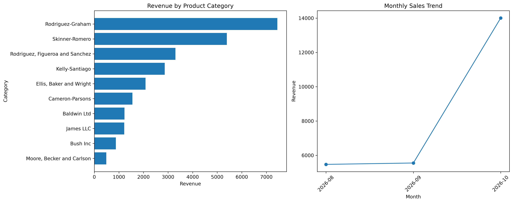
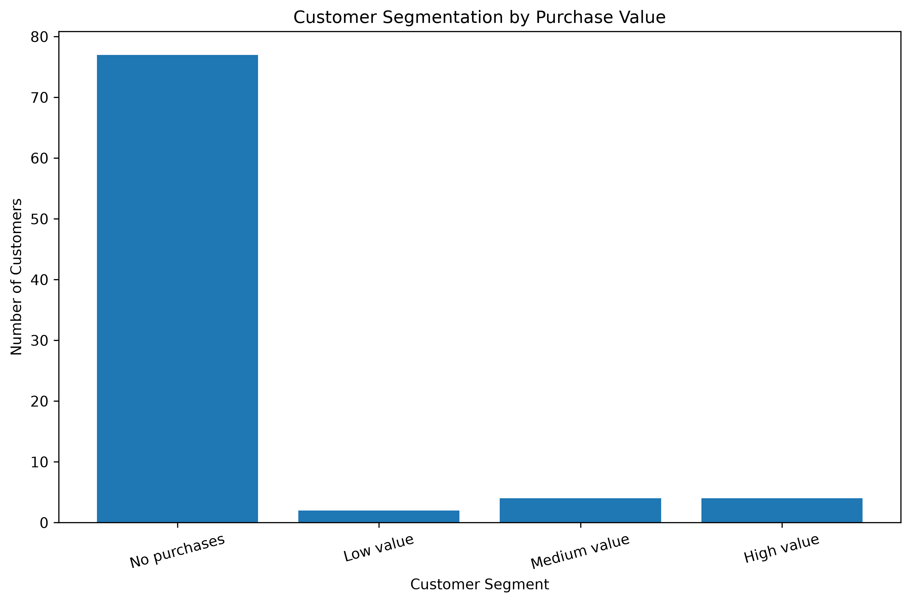
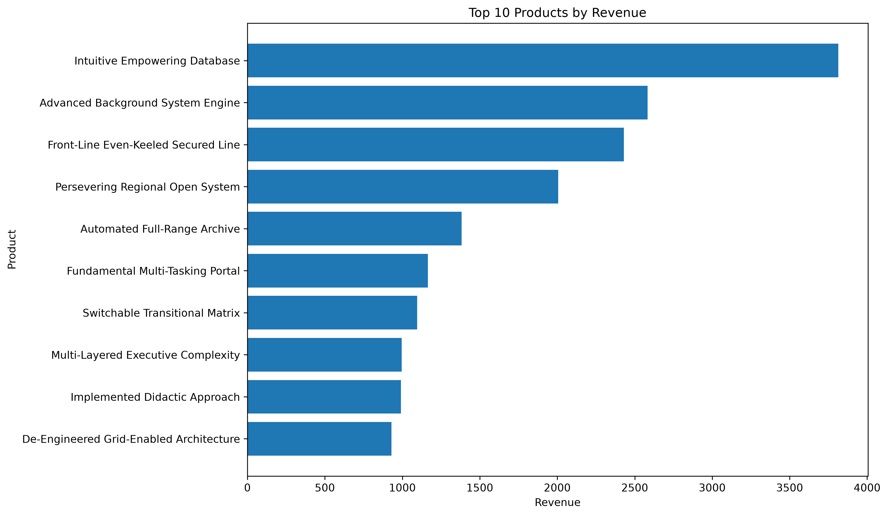
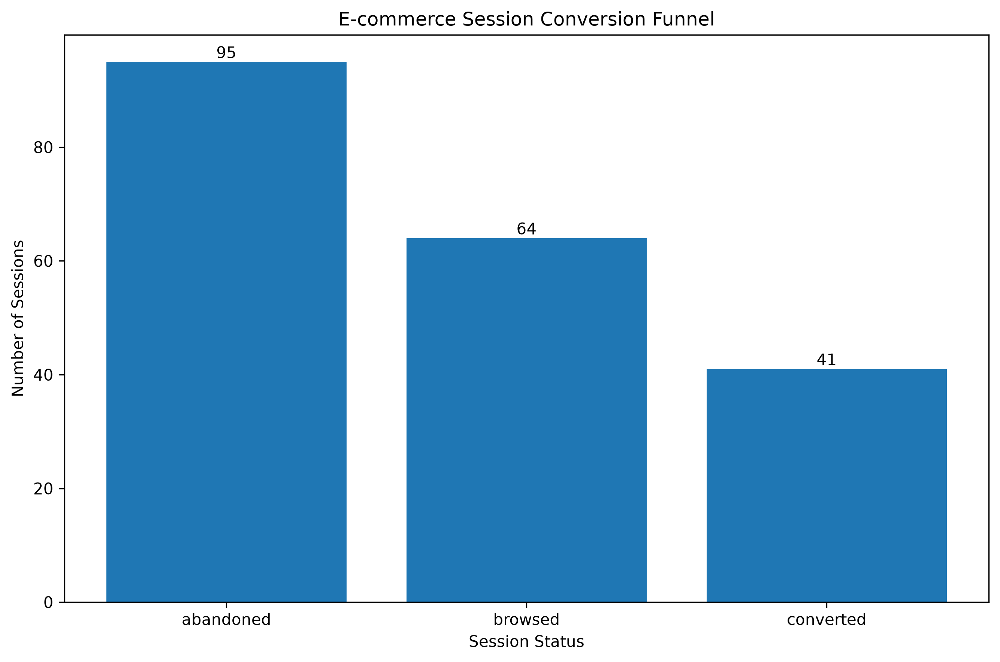

# DISTRIBUTED MULTI-MODEL ANALYTICS FOR E-COMMERCE DATA

**Final Project – Big Data Analytics**

**Student:** Gisele Ishimwe (101407)  
**Project:** Distributed Multi-Model Analytics for E-commerce Data  
**Technologies:** MongoDB, Apache HBase, Apache Spark, Python and Docker  
**Date:** November 2026

---

## 1. Introduction

The growth of e-commerce platforms has increased the amount and variety of data generated through customer profiles, product catalogues, purchases and browsing activities. Managing these different data types efficiently requires appropriate storage models and analytical technologies.

This project implements a distributed multi-model analytics solution for e-commerce data using MongoDB, Apache HBase and Apache Spark. Each technology serves a different purpose: MongoDB stores structured and semi-structured business records, HBase stores customer session and browsing information, and Spark processes data to generate analytical insights.

The project uses a generated e-commerce dataset containing customer information, products, categories, transactions and browsing sessions.

### 1.1 Project Objectives

The main objectives are to:

- Implement document-based data storage using MongoDB.
- Design and populate an HBase wide-column table for customer sessions.
- Apply Apache Spark to clean, transform and analyse e-commerce data.
- Perform customer value, product performance, sales trend and conversion analyses.
- Produce visualizations that support business decision-making.
- Evaluate the strengths and limitations of the selected technologies.

## 2. System Architecture and Technologies

The solution follows a multi-model data architecture in which different technologies handle data according to their strengths.

### 2.1 Technologies Used

**MongoDB**

MongoDB was used as the document-oriented database for customer profiles, product information, categories and transactions. Its flexible document structure supports nested records and arrays, making it suitable for e-commerce data.

**Apache HBase**

Apache HBase was used as a wide-column database for customer session and browsing information. It supports row-key-based access and storage through column families.

**Apache Spark**

Apache Spark 3.5.9 was used for data cleaning, transformation, SQL analysis and integrated analytics. Processing was executed locally using Spark's local execution mode.

**Python and Docker**

Python was used to generate datasets, prepare HBase loading commands, perform analysis and create charts. Docker provided the environment for running HBase.

### 2.2 Architecture Workflow

The project follows this workflow:

1. Generate representative e-commerce datasets using Python.
2. Store customer, product, category and transaction records in MongoDB.
3. Store customer session records in HBase.
4. Load and clean datasets using Apache Spark.
5. Execute analytical queries and integrated analysis.
6. Export analytical results and generate visualizations.
7. Interpret the results to identify business insights.

**Figure 1: System Architecture**

The architecture diagram illustrates the overall workflow of the project, showing how e-commerce data is generated, stored in MongoDB and HBase, processed and analysed using Apache Spark, and transformed into visualizations and business insights.

## 3. Data Modelling and Storage

### 3.1 Dataset Description

The project uses five generated datasets:

| Dataset | Number of records | Purpose |
|---|---:|---|
| Users | 100 | Customer profiles |
| Products | 50 | Product catalogue |
| Categories | 10 | Product classification |
| Transactions | 100 | Purchase records |
| Customer sessions | 200 | Browsing and session activity |

The datasets provide a representative environment for testing multi-model data storage and analytical processing.

### 3.2 MongoDB Data Model

MongoDB was selected to store the main e-commerce business entities.

The `ecommerce_analytics` database contains four collections:

- `users`: stores customer identifiers, geographical information, registration dates and last activity.
- `products`: stores product identifiers, names, categories, prices, stock levels and price history.
- `categories`: stores category information and nested subcategories.
- `transactions`: stores purchase details, customer identifiers, timestamps, purchased items, discounts, totals, payment methods and transaction status.

The transaction collection contains nested item arrays. This structure allows one transaction to contain multiple purchased products.

Two aggregation pipelines were implemented.

**Sales analysis:** The first pipeline filters delivered transactions, expands purchased items, joins product and category information, and calculates revenue, units sold and transaction counts by category.

**Customer analysis:** The second pipeline groups delivered transactions by customer and calculates total spending, purchase count and average order value. It also joins customer profile information.

These operations demonstrate MongoDB's ability to perform multi-stage aggregation and combine related documents.

### 3.3 HBase Data Model and Implementation

HBase was used to store customer browsing sessions in a table named `customer_sessions`.

The table contains five column families:

| Column family | Stored information |
|---|---|
| session | Session ID, start time, end time and duration |
| activity | Viewed products, page views and cart contents |
| device | Device type, operating system and browser |
| location | City, state, country and IP address |
| conversion | Conversion status and referral source |

The row key follows this structure:

`user_id#reverse_timestamp#session_id`

This design groups records by customer and supports retrieval of a customer's session history.

A Python loading script generated HBase shell commands from the session JSON dataset. A total of 200 session records were successfully inserted.

Testing confirmed that:

- The table contained 200 rows.
- Sample records could be retrieved using `scan`.
- Sessions belonging to an individual customer could be retrieved using a row-key range.
- The table structure contained all five column families.

HBase 4.0.0-alpha-1-SNAPSHOT was deployed in standalone mode inside Docker. This implementation demonstrates the data model and query operations but does not represent a distributed production cluster.

**Figure 2: HBase table and session verification**

## 4. Apache Spark Data Processing and SQL Analytics

Apache Spark 3.5.9 was used to process the generated datasets and perform analytical operations.

### 4.1 Data Cleaning and Transformation

The Spark processing script loads the JSON datasets, applies data transformations and prepares the information for analysis.

The processing activities include:

- Loading users, products, categories, transactions and sessions.
- Cleaning and normalizing the data.
- Transforming transaction timestamps.
- Expanding nested transaction item arrays.
- Registering temporary views for SQL queries.
- Exporting analytical results into CSV output folders.

### 4.2 Spark SQL Analysis

Several Spark SQL analyses were implemented:

**Sales by category:** Calculates revenue and units sold for different product categories.

**Customer value:** Calculates customer spending, purchase frequency and average order value.

**Product performance:** Identifies products with the highest revenue and units sold.

**Daily sales trends:** Examines sales activity over time.

**Session conversion funnel:** Analyses the distribution of customer sessions according to their conversion status.

The results were exported for further analysis and visualization.

### 4.3 Processing Environment

Spark was executed using local mode (`local[*]`) on the project computer. This allowed the implementation and testing of Spark processing without requiring a separate multi-node Spark cluster.

## 5. Integrated Analytics and Business Findings

The integrated analytics stage combines customer, product, transaction and session information to generate business insights.

### 5.1 Customer Lifetime Value Indicators

Customer value was calculated using available delivered transaction records. The analysis considered total spending, number of purchases and average order value.

The highest recorded customer value was:

- Customer: `user_000045`
- Purchase count: 2
- Total spending: 4,162.39
- Average order value: 2,081.19

This analysis provides an indicator of customer value based on the available dataset. It is not a predictive lifetime value model.

### 5.2 Product Affinity Analysis

Product affinity analysis was performed by identifying products purchased together within the same transaction.

This helps identify product combinations that could support cross-selling, product bundling and recommendation strategies.

### 5.3 Customer Conversion Analysis

The 200 browsing sessions were grouped by conversion status.

| Session status | Number of sessions | Percentage |
|---|---:|---:|
| Abandoned | 95 | 47.5% |
| Browsed | 64 | 32.0% |
| Converted | 41 | 20.5% |
| **Total** | **200** | **100%** |

The results show that 20.5% of recorded sessions converted, while 47.5% were abandoned.

This suggests an opportunity to investigate reasons for cart abandonment and improve the customer purchasing experience.

### 5.4 Product Performance

The highest-revenue product identified in the Spark analysis was:

- Product ID: `prod_00037`
- Product name: Intuitive Empowering Database
- Revenue: 3,814.30
- Units sold: 7

This information can help businesses identify high-performing products and support inventory and marketing decisions.

### 5.5 Monthly Sales Analysis

Monthly sales analysis was implemented to examine revenue patterns across the available transaction dates. The results provide a foundation for identifying changes in sales performance and planning future promotional activities.

**Figure 3: Integrated analytics results**

## 6. Data Visualizations

Four visualizations were designed to communicate the analytical findings.

1. **Sales overview:** Presents sales performance across categories and time.
2. **Customer segmentation:** Illustrates customer value and spending patterns.
3. **Product performance:** Highlights products based on revenue and sales volume.
4. **Conversion funnel:** Shows the distribution of abandoned, browsed and converted sessions.

These visualizations make analytical results easier to understand and help identify areas that require business attention.

**Figure 4: Sales overview**

**Figure 5: Customer segmentation**

**Figure 6: Product performance**

**Figure 7: Conversion funnel**

## 7. Scalability, Limitations and Future Improvements

### 7.1 Scalability

The selected technologies provide different opportunities for scaling an e-commerce analytics environment.

MongoDB supports flexible document storage and can scale through sharding. HBase is designed for large-scale distributed storage across multiple servers. Apache Spark supports parallel processing and can run across multiple worker nodes.

Together, these technologies demonstrate how different data models can support different operational and analytical requirements.

### 7.2 Limitations

The project has several limitations:

- The dataset is generated and relatively small, rather than collected from a live e-commerce platform.
- HBase was deployed in standalone Docker mode rather than as a distributed cluster.
- Spark was executed in local mode rather than on a multi-node cluster.
- Customer lifetime value is based on the available transaction history and is not a predictive model.
- Spark integrated analytics used the original session JSON data alongside transaction data. HBase was populated and queried separately; a direct Spark-to-HBase integration was not implemented.
- The analyses are limited by the size and characteristics of the generated dataset.

### 7.3 Future Improvements

Future development could include:

- Using a larger real-world e-commerce dataset.
- Deploying HBase and Spark on distributed clusters.
- Integrating Spark directly with HBase.
- Implementing real-time analytics using Kafka.
- Developing machine-learning-based recommendation and customer value prediction models.
- Building an interactive dashboard for business users.

## 8. Conclusion

This project successfully demonstrates a multi-model analytics solution for e-commerce data using MongoDB, Apache HBase and Apache Spark.

MongoDB provided flexible document storage and aggregation capabilities for customers, products, categories and transactions. HBase demonstrated wide-column storage and customer-based retrieval of 200 browsing sessions. Apache Spark supported data cleaning, SQL analysis, integrated analytics and the generation of analytical outputs.

The findings identified customer spending patterns, product performance and session conversion behaviour. The conversion analysis showed that 20.5% of sessions converted, while 47.5% were abandoned, highlighting an opportunity to improve the purchasing experience.

Overall, the project demonstrates how combining different database models and analytical processing technologies can support data-driven e-commerce decision-making. Although the implementation used local and standalone environments, it provides a foundation for future development into a larger distributed analytics platform.

## References

1. Apache Software Foundation. Apache Spark Documentation. https://spark.apache.org/docs/3.5.9/
2. Apache Software Foundation. Apache HBase Documentation. https://hbase.apache.org/
3. MongoDB. MongoDB Manual. https://www.mongodb.com/docs/manual/
4. Python Software Foundation. Python Documentation. https://docs.python.org/3/
